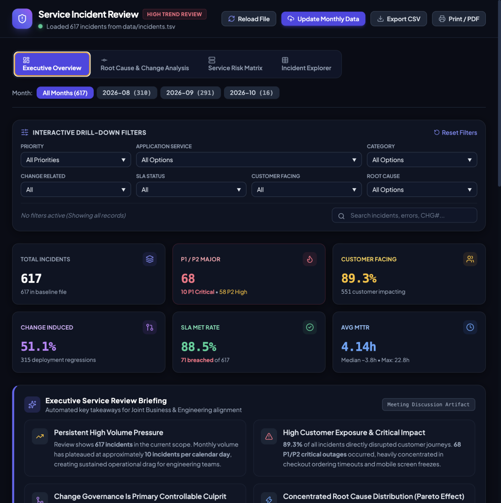
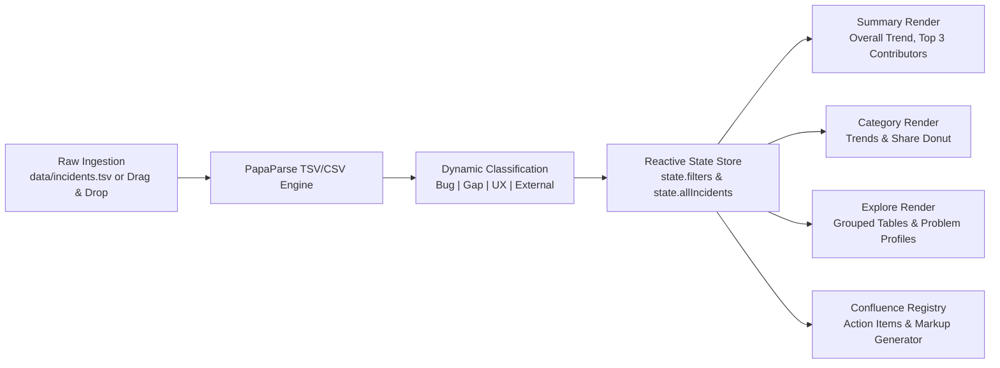

# IncidentIQ — Service Incident Review & Operations Intelligence

[](https://github.com/sathishctech/incident-iq)
[](#visual-design-system--styling-tokens)
[](#zero-hardcoding-data-architecture)
[](#license)

**IncidentIQ** is an executive and operational intelligence platform designed for joint **Business & Engineering Service Review calls** and enterprise **Problem Management (ITIL/SRE)**. It bridges the gap between high-level executive risk assessment and engineering root-cause remediation by transforming raw incident datasets into structured operational intelligence, continuous improvement workflows, and Atlassian Confluence post-mortem documentation.



---

## 📑 Table of Contents
1. [Core Purpose & Problem Management Philosophy](#core-purpose--problem-management-philosophy)
2. [Key Sections & Functional Architecture](#key-sections--functional-architecture)
   - [Summary Section](#1-summary-section)
   - [Explore Section](#2-explore-section)
   - [Call to Action (Confluence CAPA Governance)](#3-call-to-action-confluence-capa-governance)
   - [Service Reliability Risk Matrix](#4-service-reliability-risk-matrix)
3. [Zero-Hardcoding Data Architecture](#zero-hardcoding-data-architecture)
4. [Visual Design System & Styling Tokens](#visual-design-system--styling-tokens)
5. [Dependencies & Technical Stack](#dependencies--technical-stack)
6. [Data Schema & File Format Specification](#data-schema--file-format-specification)
7. [Getting Started & Local Development](#getting-started--local-development)
8. [Confluence Integration & Post-Mortem Standard](#confluence-integration--post-mortem-standard)
9. [Project Directory Layout](#project-directory-layout)

---

## 🎯 Core Purpose & Problem Management Philosophy

Traditional incident dashboards focus solely on reactive symptoms (e.g. raw ticket counts, MTTR, SLA breached percentages). **IncidentIQ** enforces proactive **Problem Management & Continuous Improvement (CAPA)** by structuring all incident data into four standardized categories:

| Problem Category | Definition | Key Failure Mechanisms | Example Offending Patterns |
| :--- | :--- | :--- | :--- |
| **Bug** | Software defects, application crashes, logic flaws, regressions | Race conditions, memory leaks, query locks, unhandled exceptions, asset cache mismatches | `Order Checkout Timeout`, `Database Query Lock`, `Frontend CDN Cache Drift` |
| **Gap** | Architectural, capacity, auto-scaling, or process blindspots | Cooldown lags, resource contention between OLTP and OLAP, unversioned schema drift | `09:00 Peak Traffic Auto-Scale Lag`, `ETL Schema Drift`, `Warehouse Compute Contention` |
| **User Experience (UX)** | Usability friction, customer confusion, authentication loops | Ambiguous error prompts, recursive login redirects, session expiration handling | `Password Reset Redirect Loop`, `Expired Credentials`, `Token Refresh Failure` |
| **External** | Third-party vendor outages, rate limits, network carriers, CDNs | SMS provider delivery latencies, vendor breaking API changes, upstream DDoS | `Third-Party SMS Gateway Latency (>120s)`, `Payment Gateway Rate Limiting`, `CDN Edge Packet Drop` |

### The 4 Pillars of Every Category Profile
For each category, IncidentIQ maintains a 4-dimensional problem management profile:
1. **Root Cause Analysis (RCA):** Unearths the systemic failure mode rather than superficial symptoms.
2. **Workaround:** Immediate containment instructions to restore production availability.
3. **Standard Operating Procedure (SOP):** Repeatable runbooks for L1/L2 on-call engineers.
4. **Permanent Fix Plan:** Engineering roadmap ticket (PRB#) and architectural backlog item to permanently eradicate recurrence.

---

## 🖥️ Key Sections & Functional Architecture

### 1. Summary Section
The Summary view is tailored for engineering leaders, directors, and business stakeholders:
* **Overall Incident Trend & MoM Delta:**
  * Displays total active incidents in scope alongside an automatic period-over-period comparison (e.g. Month-over-Month $\pm\%$) to detect whether incident velocity is accelerating.
  * A continuous inflow timeline curve (`Chart.js` cubic spline gradient) visualizing daily or monthly inflow volume.
* **Category Trend & Distribution:**
  * Four dedicated category metric cards (**Bug**, **Gap**, **User Experience**, **External**) displaying absolute count, percentage share of total, and dynamic progress bars.
  * **Category Incident Volume Trend Chart:** Multi-series line chart tracking the trajectory of each category over monthly release cycles.
  * **Category Share Donut Chart:** Visual breakdown of relative contribution across categories.
* **Top Three Contributors per Category Grid:**
  * A 4-column responsive grid analyzing each category's top contributors:
    1. **Top 3 Impacted Applications & Systems** (with incident counts and percentage progress bars).
    2. **Top 3 Root Cause Classifications**.
    3. **Primary Assignment Teams** responsible for remediation.
  * Direct *"Explore Records"* one-click drill-down into any category.
* **Change-Related Incident Trend vs. Overall Inflow:**
  * Evaluates whether deployments and configuration changes are driving an increasing proportion of outages.
  * Grouped combo chart: Total Inflow (Bar) vs. Change-Induced Outages (Bar) vs. Change Share % (Line on secondary Y-axis).
  * **Executive Assessment Box:** Automatically detects the change-induced ratio (e.g. `62.5% of current incidents caused by changes, up +14.1% over baseline`) and proposes strategic canary and database lock controls.

---

### 2. Explore Section
The Explore view serves on-call engineers, incident commanders, and problem managers:
* **Category Group Switcher:** Interactive pills (`ALL Group`, `Bug Group`, `Gap Group`, `User Experience Group`, `External Group`) with real-time count badges.
* **Category Problem Management Profile Card:** Dynamic briefing displaying Root Cause, Workaround, SOP, and Permanent Fix Plan for the active category, with a *"Copy Problem Summary"* button.
* **Grouped Incident Records Explorer:**
  * Filterable, sortable, and paginated table with column headers for Incident Number, Opened Timestamp, Application Service, Category badge, Priority badge, Root Cause, Change ID, and MTTR hours.
  * **Slide-Over Incident Detail Drawer:** Modal showing comprehensive record attributes, change correlation (`Caused_By_Change`), resolution time, and a *"Copy Incident for Confluence RCA"* button.

---

### 3. Call to Action (Confluence CAPA Governance)
Eliminates post-mortem drop-off by bridging dashboard analytics directly into Jira and Confluence:
* **CAPA Action Registry Table:**
  * Tracks high-priority remediation items with **Action ID**, **Description & Linked Record** (e.g. `INC0104501 / PRB-2026-004`), **Category**, **Owner**, **Due Date**, and **Status** (`In Progress`, `Planned`, `Completed`).
* **One-Click Confluence Storage Markup Export:**
  * Formats the entire registry as a native Confluence table markup ready to paste directly into your Atlassian Confluence Post-Incident Review (PIR) template.
* **Export Actions CSV:** Downloadable CSV file for integration with project management tools.

---

### 4. Service Reliability Risk Matrix
Deep-dive table ranking all application services by computed risk exposure:
$$\text{Risk Score} = (P_{1/2} \times 4) + (\text{Change Incidents} \times 1.5) + (\text{Total Count} \times 0.5) - (\text{SLA Compliance \%} \times 0.2)$$
* Categorizes each service into **Critical**, **Elevated**, or **Low** risk tiers.
* Click any service row to filter the entire dashboard down to that specific microservice.

---

## ⚡ Zero-Hardcoding Data Architecture

IncidentIQ is built with **zero hardcoded values**. Every metric, percentage, delta, contributor list, and category assignment is dynamically calculated on the client side:



### Monthly Data Update Workflow
1. **Option A (Disk Replacement):** Replace `data/incidents.tsv` on disk and click the **"Reload File"** button in the header.
2. **Option B (In-Browser Drag & Drop):** Click **"Update Monthly Data"** in the top navigation bar and drop any updated `.tsv` or `.csv` file. The dashboard parses and re-renders all charts and metrics instantly.

---

## 🎨 Visual Design System & Styling Tokens

IncidentIQ adheres to the **UI/UX Pro Max** design system, combining an **OLED Dark Canvas** with **Bento Box glassmorphism**, vibrant category accents, and high-legibility typography.

### 1. Color Palette Tokens
| Token | Hex / CSS Value | Semantic Role |
| :--- | :--- | :--- |
| `--bg-dark` | `#090D16` | Pure OLED background canvas |
| `--card-dark` | `#101626` | Bento card container base |
| `--card-border` | `rgba(255, 255, 255, 0.07)` | Translucent card border |
| `brand-500` | `#6366F1` (Indigo) | Primary active state & brand elements |
| `category-bug` | `#EF4444` (Rose) | Software defects, code crashes, locks |
| `category-gap` | `#F59E0B` (Amber) | Capacity, scaling lag, resource contention |
| `category-ux` | `#3B82F6` (Blue) | Usability friction, password resets, tokens |
| `category-ext` | `#A855F7` (Purple) | External vendors, third-party APIs, CDNs |
| `status-ok` | `#10B981` (Emerald) | SLA compliance, completed actions, health |

### 2. Typography
* **Primary Sans-Serif:** `'Plus Jakarta Sans'`, `-apple-system`, `BlinkMacSystemFont`, `sans-serif` (weights: 400, 500, 600, 700, 800) for clean editorial hierarchy.
* **Code / Numerical Monospace:** `'Fira Code'`, `ui-monospace`, `monospace` (weights: 400, 600) for incident IDs (`INC0104501`), timestamps, SLA figures, and percentages.

### 3. Glassmorphism & Micro-Interactions
* **Glass Card Effect:**
  ```css
  .glass-card {
    background: rgba(16, 22, 38, 0.85);
    backdrop-filter: blur(16px);
    -webkit-backdrop-filter: blur(16px);
    border: 1px solid rgba(255, 255, 255, 0.07);
    box-shadow: 0 4px 20px -2px rgba(0, 0, 0, 0.5);
    transition: all 0.25s cubic-bezier(0.16, 1, 0.3, 1);
  }
  .glass-card:hover {
    border-color: rgba(99, 102, 241, 0.3);
    box-shadow: 0 8px 30px -4px rgba(99, 102, 241, 0.15);
  }
  ```
* **Status Indicators:** `.live-pulse` CSS keyframe pulsing dot for live data connection status.
* **Print Styles:** Optimized `@media print` rules removing navigational chrome and rendering cards with high-contrast borders for physical executive handouts.

---

## 📦 Dependencies & Technical Stack

IncidentIQ runs completely self-contained in the browser with **zero npm dependencies, zero build steps, and zero bundlers**:

| Library | Version / Source | Purpose |
| :--- | :--- | :--- |
| **Tailwind CSS** | `CDN (v3.x)` | Utility-first responsive grid, typography, flexbox |
| **Chart.js** | `v4.4.1 (UMD)` | High-performance HTML5 canvas rendering for line, bar, and donut charts |
| **Lucide Icons** | `vLatest` | Modern, consistent SVG iconography (`zap`, `bug`, `globe`, `split`, etc.) |
| **PapaParse** | `v5.4.1` | Robust, in-browser streaming TSV & CSV parsing |
| **Python 3** | `Built-in (serve.py)` | Zero-dependency local development HTTP server with CORS headers |

---

## 📋 Data Schema & File Format Specification

The source dataset is stored in `data/incidents.tsv` (Tab-Separated Values). The schema matches standard enterprise IT Service Management (ITSM) systems:

```tsv
Number	Opened	Opened_Month	Resolved	State	Application_Service	Customer_Facing	Category	Subcategory	Priority	Root_Cause	Change_Related	Caused_By_Change	Assignment_Group	Resolution_Time_Hours	SLA_Met	Short_Description
```

### Field Definitions
* `Number`: Unique incident ticket identifier (e.g. `INC0104501`).
* `Opened`: ISO datetime of incident creation (`YYYY-MM-DD HH:MM:SS`).
* `Opened_Month`: Normalized month key (`YYYY-MM`).
* `Resolved`: ISO datetime of ticket resolution.
* `State`: Current lifecycle status (`Closed`, `Resolved`, `In Progress`).
* `Application_Service`: Impacted business application or microservice.
* `Customer_Facing`: Boolean flag (`Yes` / `No`) indicating external user disruption.
* `Category`: ITSM functional category.
* `Subcategory`: Granular incident symptom.
* `Priority`: Normalized priority string (`1 - Critical`, `2 - High`, `3 - Moderate`, `4 - Low`).
* `Root_Cause`: Diagnosed technical root cause classification.
* `Change_Related`: Boolean flag (`Yes` / `No`) indicating if a change triggered the incident.
* `Caused_By_Change`: Associated Change Request ID (e.g. `CHG0030158`).
* `Assignment_Group`: Engineering or operations team responsible for remediation.
* `Resolution_Time_Hours`: Decimal duration from open to resolution.
* `SLA_Met`: Boolean flag (`Yes` / `No`).
* `Short_Description`: Detailed failure symptom summary.

---

## 🚀 Getting Started & Local Development

### Option 1: Built-in HTTP Server (Recommended)
IncidentIQ includes a lightweight Python HTTP server (`serve.py`) that sets no-cache and CORS headers:

```bash
# Clone the repository
git clone https://github.com/sathishctech/incident-iq.git
cd incident-iq

# Start the server (serves on port 3000)
python3 serve.py
```
Open **[http://localhost:3000](http://localhost:3000)** in your browser.

### Option 2: Single-Click Shell Script
```bash
chmod +x start.sh
./start.sh
```

### Option 3: Direct File Execution (Zero Install)
You can directly open `index.html` in Chrome, Safari, Firefox, or Edge:
```bash
open index.html
```
*(The application includes an offline embedded baseline dataset in `data/incidents-data.js` so it functions fully even under restricted `file://` sandboxes).*

---

## 📝 Confluence Integration & Post-Mortem Standard

When preparing your monthly Post-Incident Review (PIR) in Atlassian Confluence:
1. Open the **Call to Action (Confluence)** tab in the dashboard.
2. Click **"Copy Confluence Markup"**.
3. In your Confluence editor, paste the clipboard content directly into a Markdown/Storage Format macro or table block.
4. Each corrective action will include:
   * **Action ID & Title**
   * **Category (Bug, Gap, UX, External)**
   * **Designated Owner & Team**
   * **Target Due Date**
   * **Direct Link to Incident / PRB Record**

---

## 📂 Project Directory Layout

```
incident-iq/
├── index.html            # Main single-page application and responsive views
├── app.js                # Core reactive engine, Chart.js managers & classification
├── styles.css            # Dark OLED tokens, glassmorphism, fonts, and print styles
├── serve.py              # Lightweight development server with CORS & no-cache
├── start.sh              # One-click startup shell script
├── screenshot.png        # High-resolution dashboard preview for GitHub & docs
├── README.md             # Human-readable end-to-end documentation
├── PROJECT.md            # AI/LLM-optimized system context & architectural spec
├── .gitignore            # Git exclusion rules
├── data/
│   ├── incidents.tsv     # Source-of-truth TSV incident dataset (617+ records)
│   ├── incidents.json    # JSON representation of incident dataset
│   └── incidents-data.js # Offline embedded fallback baseline
└── snippets/             # Component verification screenshots
    ├── 01_executive_overview_and_kpis.png
    ├── 02_incident_trends_and_pareto_analysis.png
    ├── 03_service_risk_matrix.png
    ├── 04_incident_explorer_and_detail_modal.png
    └── 05_call_to_action_confluence.png
```

---

## 📄 License
This project is licensed under the **MIT License** — free for internal enterprise and commercial operational use.
